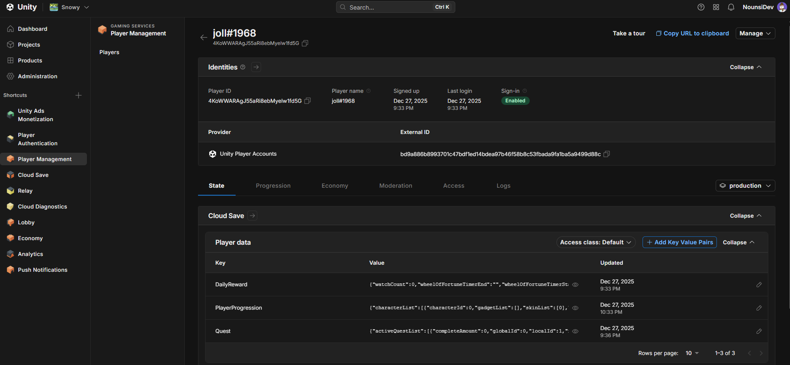
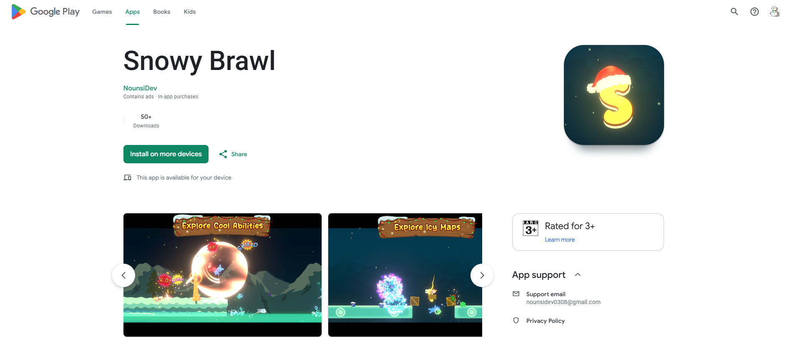

## 1.  Overview
<video autoplay loop muted playsinline style="max-width: 100%; border-radius: 10px;">
  <source src="/assets/images/snowy_brawl_preview.mp4" type="video/mp4">
</video>
Fast-paced 2D multiplayer ragdoll physics game using **Netcode for Gameobjects** and **Objects Pooling** to maintain 60 FPS across multi-client sessions. Allowing up 
to 4 players per section with customizable teams, weapons and gamemodes
  
Role: Solo Developer  
Tech Stack: Unity 6, C#, Netcode for GameObjects, Unity Gaming Services, Unity Ads, Google Play Services  
Target Platform: Mobile  
Links: [Google Play Store](https://play.google.com/store/apps/details?id=com.NounsiDev.Snowy&pcampaignid=web_share)

## 2. Key Technical Highlights
* **Networking:**
<video autoplay loop muted playsinline style="max-width: 100%; border-radius: 10px;">
  <source src="/assets/images/Lobby.mp4" type="video/mp4">
</video>

  Built on **Netcode for GameObjects (NGO)** as the core networking framework, integrated with **Unity Lobby** for seamless matchmaking and a **Relay server** utilizing UDP for low-overhead transport. To combat an average 120ms round-trip time (RTT) and mask network jitter, a hybrid client-side smoothing pipeline implements both interpolation and extrapolation to gracefully handle lag spikes.   

<video autoplay loop muted playsinline style="max-width: 100%; border-radius: 10px;">
  <source src="/assets/images/Fight Clip.mp4" type="video/mp4">
</video>

  All physics-driven movement utilizes delta synchronization to maintain consistent behavior across varying client frame rates while minimizing bandwidth overhead. Conversely, discrete, one-time gameplay actions are routed via client-to-server RPCs; the authoritative server then broadcasts the response to all connected peers. A deliberate network buffer delay is implemented on these actions to balance responsiveness and mitigate host advantage.  
   Furthermore, player state replication is optimized by synchronizing only the root transform and four key limb rotation variables; through empirical testing, utilizing **half-precision floats (16-bit)** and change-detection thresholds successfully minimized network payload overhead.

---

* **Cloud Saving:**

  

  Both Authentication and Cloud Saving are using UGS ( Unity Gaming Service) - which also provide lobby, player-matching, relay server. Although all the data is read-only for the owner client, it can be configured to be read-only by other clients to support system like Friends and Clan. 

---

* **Google Play Services:**

  

  

 Successfully navigated full production lifecycles—spanning internal testing, closed testing, and a public Google Play Store release in December 2025. Integrated a suite of core Google Play APIs, including Play Integrity for security, Google Mobile Ads, Play Games Services, and Analytics to track real-time player telemetry and ensure production stability.

---

* **Object Pooling:**

---

* **Flyweight Design Pattern:**

  

  

  Decoupled all character and weapon statistics into dedicated ScriptableObjects, establishing a single source of truth for game data.

<video autoplay loop muted playsinline style="max-width: 100%; border-radius: 6px;">
  <source src="/assets/images/Book.mp4" type="video/mp4">
</video>

  This modular architecture simplifies balance tweaks in the editor, streamlines data management, and ensures the codebase remains clean and scalable as the project expands.

---

* **Customizable Controls:**
<video autoplay loop muted playsinline style="max-width: 100%; border-radius: 6px;">
  <source src="/assets/images/Customize.mp4" type="video/mp4">
</video>

  Engineered a custom UI preference system empowering players to tailor their layout and settings to individual playstyles. Settings are serialized and stored locally via JSON configuration files, ensuring that multi-device cross-play environments seamlessly adapt to varying hardware resolutions.

